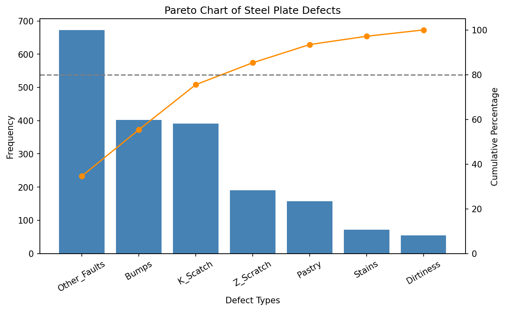

# Pareto Analysis of Steel Plate Defects

A Pareto analysis in Python showing which defect types cause most of the problems on steel plates.



## Question

Which defect types should a quality team focus on first?

## Data

[UCI Steel Plates Faults](https://archive.ics.uci.edu/dataset/198/steel+plates+faults): 1,941 defects, each labelled with one of 7 defect types.

## Method

The notebook [pareto_analysis.ipynb](pareto_analysis.ipynb) follows the standard Pareto steps:

1. Check the data (empty cells, duplicates, one label per defect)
2. Count each defect type
3. Sort from highest to lowest
4. Calculate the cumulative percentage
5. Plot bars (frequency) and a line (cumulative %) with an 80% reference line
6. Identify the "vital few"

## Findings

- **4 of 7 defect types cause about 85% of defects:** Other_Faults, Bumps, K_Scatch, Z_Scratch.
- The 80/20 rule is a guide, not a law: here 57% of the types make up 85% of the defects.
- The largest category is **Other_Faults (35%)**, a catch-all. A good first step is to record these defects more precisely.
- **Bumps and K_Scatch** (about 20% each) are the largest named types and the best candidates for root-cause analysis.

**Limitation:** every row is a defect, so this compares defect types with each other. It does not show a defect rate.

## Run it

```bash
pip install -r requirements.txt
jupyter notebook pareto_analysis.ipynb
```

## Output files

- `pareto_chart.png`: the chart
- `pareto_table.csv`: frequency, percentage and cumulative percentage per defect type (for Power BI)
- `defects.csv`: one row per defect with its type (for Power BI)
